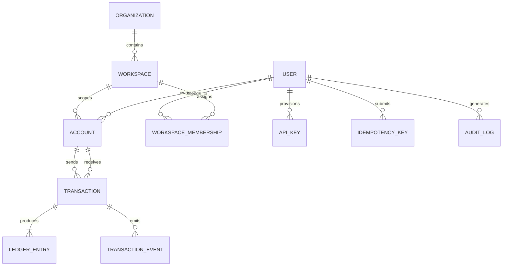

# DataCore — PostgreSQL Database Engineering & Schema Guide

---

## 1. Schema & Entity-Relationship Architecture

DataCore operates on an authoritative relational model designed for strict financial consistency, row-level locking, and immutability.



---

## 2. Table Specifications & Constraints

### 2.1 `engine_account`
- `id` (UUID, Primary Key)
- `account_number` (VARCHAR(32), Unique, Index) e.g., `DC-7489-1024`
- `user_id` (UUID, Foreign Key -> `authentication_user`)
- `balance` (DECIMAL(14,2), Default `0.00`, Constraint: `balance >= 0.00`)
- `currency` (VARCHAR(3), Default `INR`)
- `version` (INT, Default `0`) — Used for optimistic locking version checks
- `is_active` (BOOLEAN, Default `True`)
- `created_at`, `updated_at` (TIMESTAMPTZ)

### 2.2 `engine_transaction`
- `id` (UUID, Primary Key)
- `sender_account_id` (UUID, Nullable Foreign Key -> `engine_account`)
- `receiver_account_id` (UUID, Foreign Key -> `engine_account`)
- `amount` (DECIMAL(14,2), Constraint: `amount > 0.00`)
- `currency` (VARCHAR(3), Default `INR`)
- `status` (VARCHAR(20), Choices: `PENDING`, `COMPLETED`, `FAILED`, `ROLLED_BACK`, `REVERSED`)
- `concurrency_strategy` (VARCHAR(30), Choices: `PESSIMISTIC`, `OPTIMISTIC`, `ATOMIC_CONDITIONAL`, `UNSAFE_BASELINE`)
- `idempotency_key` (VARCHAR(255), Nullable, Indexed)
- `description` (TEXT)
- `failure_reason` (TEXT)
- `latency_ms` (FLOAT)
- `created_at` (TIMESTAMPTZ, Indexed)
- `completed_at` (TIMESTAMPTZ, Nullable)

### 2.3 `engine_ledgerentry`
- `id` (UUID, Primary Key)
- `transaction_id` (UUID, Nullable Foreign Key -> `engine_transaction`)
- `account_id` (UUID, Foreign Key -> `engine_account`)
- `entry_type` (VARCHAR(10), Choices: `DEBIT`, `CREDIT`, Indexed)
- `amount` (DECIMAL(14,2), Positive)
- `balance_after` (DECIMAL(14,2))
- `description` (VARCHAR(255))
- `created_at` (TIMESTAMPTZ, Indexed)

**Immutability Guarantee:** Ledger rows are append-only. No `UPDATE` or `DELETE` statements are ever executed against `engine_ledgerentry`.

### 2.4 `engine_idempotencykey`
- `id` (UUID, Primary Key)
- `user_id` (UUID, Foreign Key)
- `key` (VARCHAR(255), Indexed)
- `request_path` (VARCHAR(255))
- `request_hash` (CHAR(64)) — SHA-256 digest of request payload
- `status` (VARCHAR(20), Choices: `PROCESSING`, `COMPLETED`, `FAILED`)
- `response_code` (INT, Nullable)
- `response_body` (JSONB)
- **Constraint:** `UNIQUE (user_id, key)`

---

## 3. Database Concurrency Control & Row Locks

### Pessimistic Row Locking (`SELECT FOR UPDATE`)
```sql
-- Executed inside BEGIN ... COMMIT
-- Canonical sorting prevents deadlock
SELECT * FROM engine_account WHERE id IN ($first_id, $second_id) ORDER BY id FOR UPDATE;
UPDATE engine_account SET balance = balance - $amount, version = version + 1 WHERE id = $sender_id;
UPDATE engine_account SET balance = balance + $amount, version = version + 1 WHERE id = $receiver_id;
INSERT INTO engine_ledgerentry (transaction_id, account_id, entry_type, amount, balance_after) ...;
COMMIT;
```

### Optimistic Lock Check
```sql
UPDATE engine_account
SET balance = balance - $amount, version = version + 1
WHERE id = $sender_id AND version = $expected_version;
-- If rowcount == 0, abort with OptimisticLockConflictException
```
