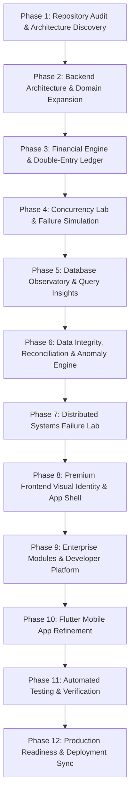

# DataCore — Enterprise Transformation Roadmap (V2)

This roadmap outlines the systematic, phased implementation plan to transform DataCore from a core concurrency engine into a premier, enterprise-grade financial transaction infrastructure, database concurrency laboratory, observability hub, and developer platform.

---

## Roadmap Phases

---

## Detailed Phase Breakdown

### Phase 1: Repository Audit & Architecture Discovery (Status: In Progress)
- [x] Clone and inspect all codebase assets.
- [x] Create core architectural documents (`IMPLEMENTATION_AUDIT.md`, `UPGRADE_ROADMAP.md`, `FEATURE_MATRIX.md`, `TECHNICAL_DEBT.md`, `ARCHITECTURE_DECISIONS.md`).
- [x] Verify Python environment and dependencies.

### Phase 2: Backend Architecture & Domain Expansion
- Add new modular Django models in `engine`:
  - `Organization` & `Workspace` (Multi-tenant hierarchy with data isolation).
  - `ApiKey` (API key hashing, permission scoping, expiration).
  - `WebhookEndpoint` & `WebhookDelivery` (HMAC signatures, delivery tracking, retries).
  - `Incident` (Incident response lifecycle: `DETECTED`, `ACKNOWLEDGED`, `INVESTIGATING`, `RESOLVED`, `CLOSED`).
  - `AnomalyRule` & `AnomalyAlert` (Rule-based risk detection).
  - `ReliabilityObjective` & `SLOMetric` (SLO tracking, error budget calculation).
  - `SettlementBatch` & `SettlementEntry` (Internal ledger batching and reconciliation).
  - `OutboxEvent` (Transactional outbox pattern with at-least-once delivery semantics).
  - `BenchmarkRecord` (Performance measurement records).
- Create database migrations.

### Phase 3: Financial Engine & Double-Entry Ledger Invariants
- Enforce strict balance constraints ($\sum \text{Debits} = \sum \text{Credits}$).
- Introduce compensating reversal workflow.
- Account-level statement generation and fee reconciliation.

### Phase 4: Advanced Concurrency & Experimentation Laboratory
- Add Deadlock Simulator demonstrating circular lock waits.
- Add Isolation Level Explorer (Read Committed, Repeatable Read, Serializable).
- Provide detailed worker execution timelines and conflict statistics.

### Phase 5: Database Observatory & Telemetry
- Database connection pool health and active/idle metrics.
- Lock contention inspector and blocked query tracking.
- Slow query monitoring and safe `EXPLAIN` query plan analysis.

### Phase 6: Data Integrity & Reconciliation Center
- Multi-dimensional consistency engine:
  - Debit/Credit equality verification.
  - Balance reconstruction from immutable ledger history.
  - Negative balance detection.
  - Orphaned ledger check.
  - Cryptographic audit trail integrity verification.
- Reconciliation report generator with downloadable reports.

### Phase 7: Distributed Systems Failure Lab
- Request retry strategies: Exponential backoff with jitter.
- Retry storm simulation.
- Circuit breaker states: Closed, Open, Half-Open.
- Bulkhead isolation demonstrations.

### Phase 8: Premium Visual Identity & React Application Shell
- Brand palette integration:
  - Soft Pink (`#F8C4DB`), Rose (`#F4A8CB`), Lavender (`#DCC5FA`), Purple (`#BFA1F5`), Peach (`#FFE1CE`), Warm White (`#FFFDFE`), Soft Gray (`#F5F2F7`), Deep Text (`#30283C`).
- Theme switcher: Light, Dark, System modes with persistence.
- Premium glassmorphism and subtle gradient surfaces.
- Ctrl+K Command Palette with quick navigation and search.
- Responsive layout with collapsible sidebar and breadcrumbs.

### Phase 9: Enterprise Modules & Developer Platform
- API Explorer and interactive playground with sample requests/responses.
- API Key management with copy-to-clipboard and secret masking.
- Webhook registration, signature verification testing, and delivery logs.
- Incident management dashboard and notification center.

### Phase 10: Flutter Mobile App Refinement
- Modern mobile UI with material design tokens and bottom navigation.
- Pull-to-refresh on account balances and transaction history.
- Transfer confirmation modal and secure token handling.

### Phase 11: Automated Testing & Verification
- Unit and integration tests for all models, views, and concurrency services.
- Concurrency stress tests verifying invariant preservation.
- Tenant isolation tests preventing cross-workspace leakage.

### Phase 12: Production Readiness & Deployment Sync
- Validate Render blueprint (`render.yaml`) and Vercel configuration.
- Comprehensive technical documentation in `docs/`.
- Final verification report.
